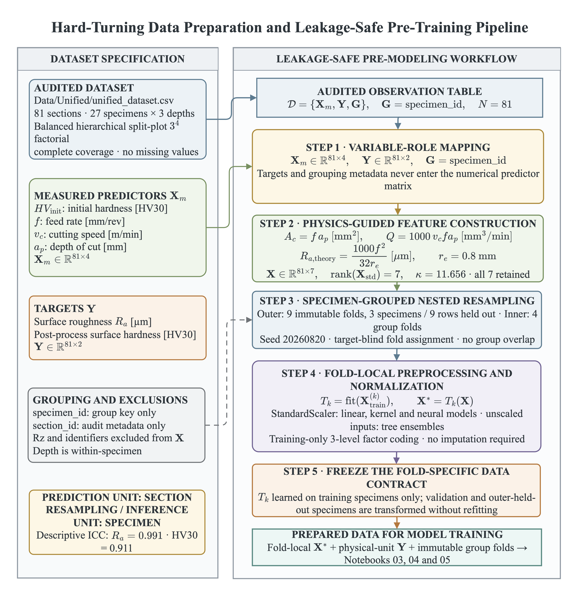
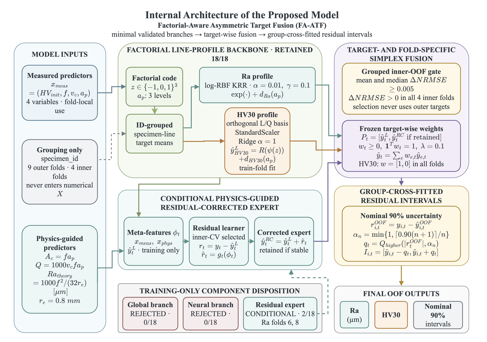
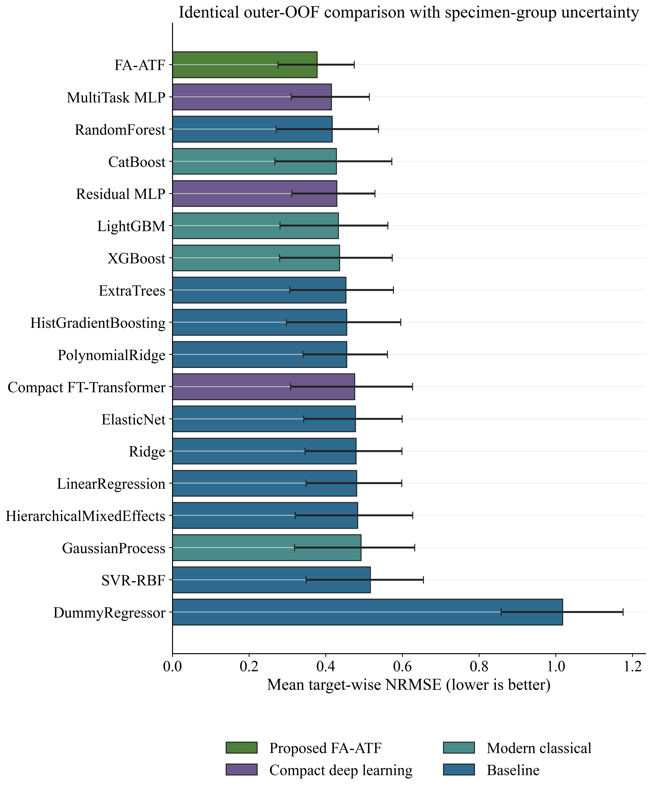

# FA-ATF for Surface-Quality Prediction in 51CrV4 Hard Turning

[](https://doi.org/10.48662/daks-69)
[](https://creativecommons.org/licenses/by-sa/4.0/)
[](#validation-design)

This repository provides notebook source and saved experimental evidence for **multi-output prediction of surface roughness (`Ra`) and post-process surface hardness (`HV30`) after hard turning of 51CrV4 steel**. The proposed method is **Factorial-Aware Asymmetric Target Fusion (FA-ATF)**, a compact target-specific fusion architecture designed for the hierarchical factorial structure of the experiment.

The package preserves the official DaKS dataset, six notebooks with saved executed outputs, matched out-of-fold (OOF) predictions, compact publication tables, and 36 manuscript-numbered figures. The published study compares 18 models on the same specimen-grouped folds. See the [dataset documentation](dataset/README.md) for the full data annotation and the [reproducibility guide](REPRODUCIBILITY.md) for verification and rerun requirements.

> **Evidence boundary.** FA-ATF has the best observed mean target-wise NRMSE in the specimen-grouped nested-CV comparison. Confirmatory superiority over the three focal model-family leaders remains **`INCONCLUSIVE`** after multiplicity-aware paired inference. No independent external validation was performed. The historical run identifier is `FA_ATF_DaKS69_Exploratory_20260820`; publication of this snapshot does not constitute a new training run.

## Abstract

Predicting complementary surface-quality responses from a small machining experiment requires a validation design that respects repeated measurements on physical specimens. This study uses 81 machined sections from 27 quenched-and-tempered 51CrV4 specimens to predict axial surface roughness and post-process Vickers hardness from initial hardness, feed rate, cutting speed, and depth of cut. FA-ATF combines a factorial line-profile backbone with optional complementary learners, target-specific fusion, and residual correction selected using training-side grouped cross-validation. Nine specimen-grouped outer folds and four grouped inner folds provide a common comparison of 18 statistical, classical machine-learning, and compact neural models. In the saved OOF results, FA-ATF attains mean target-wise NRMSE of 0.3773, compared with 0.4145 for MultiTask MLP, 0.4165 for RandomForest, and 0.4274 for CatBoost. Specimen-level resampling and multiplicity-adjusted paired tests support a bounded interpretation: the observed ranking favors FA-ATF, while confirmatory superiority over these leading comparators remains inconclusive. The repository makes the source data, modeling contracts, executed notebook outputs, predictions, statistical tables, and figures available for inspection and reconstruction.

## Contents

- [Research question and contribution](#research-question-and-contribution)
- [Dataset, provenance, and scientific basis](#dataset-provenance-and-scientific-basis)
- [Validation design](#validation-design)
- [Proposed method](#proposed-method)
- [Results](#results)
- [Repository structure](#repository-structure)
- [Reproduction](#reproduction)
- [Limitations](#limitations)
- [Licensing and citation](#licensing-and-citation)
- [Figure and artifact indexes](#figure-and-artifact-indexes)

## Research question and contribution

This study asks whether a compact, factorial-aware and target-specific fusion model can improve out-of-sample prediction of two physically different surface-quality responses while respecting the specimen hierarchy of a small machining experiment.

The repository makes five concrete contributions:

1. a transparent modeling contract for the measured process factors, physics-guided deterministic transforms, targets, grouping variables, and inference-time feature availability;
2. leakage-safe comparison of dummy, statistical, classical ML, modern boosting/kernel, and compact deep-learning models on identical specimen-grouped outer folds;
3. training-side construction of one minimal FA-ATF architecture with target-specific fusion, genuine residual correction, and specimen-aware residual intervals;
4. matched OOF evaluation with cluster bootstrap, paired tests, rank stability, controlled ablations, alternative fold assignments, and within-domain robustness analyses; and
5. an inspectable scientific workflow comprising six notebooks, compact numerical artifacts, and manuscript-numbered figures.

| Item | Definition |
|---|---|
| Material and process | Hard turning of quenched-and-tempered 51CrV4 steel |
| Unit of observation | Machined section |
| Independent grouping unit | Physical specimen |
| Sample structure | 81 sections nested within 27 specimens; three sections per specimen |
| Measured predictors | Initial hardness (`HV_init`, HV30), feed rate (`f`, mm/rev), cutting speed (`v_c`, m/min), depth of cut (`a_p`, mm) |
| Physics-guided transforms | `f × a_p`, `1000 × v_c × f × a_p`, and kinematic roughness using the fixed 0.8 mm PCBN corner radius |
| Targets | Surface roughness `Ra` (µm) and post-process surface hardness (HV30) |
| Primary joint criterion | Mean target-wise NRMSE; lower is better |
| Secondary criteria | Target-wise MAE, RMSE, R², uncertainty, stability, and latency |

## Dataset, provenance, and scientific basis

### Official source and repository location

The only experimental dataset used in this project was downloaded from **DaKS, the official research-data repository of the University of Kassel**:

> Wittich, F., Wegener, T., Liehr, A., Zinn, W., Niendorf, T., & Kroll, A. (2025). **Surface layer state after hard turning of 51CrV4** [Data set]. DaKS, University of Kassel. [https://doi.org/10.48662/daks-69](https://doi.org/10.48662/daks-69)

- Official DaKS record: [daks.uni-kassel.de/entities/dataset/14ec53e8-1bf9-42d2-b653-5d54b3962364](https://daks.uni-kassel.de/entities/dataset/14ec53e8-1bf9-42d2-b653-5d54b3962364)
- Persistent identifier: [DOI 10.48662/daks-69](https://doi.org/10.48662/daks-69)
- Data license: [Creative Commons Attribution-ShareAlike 4.0 International](https://creativecommons.org/licenses/by-sa/4.0/)
- Original file selected from the DaKS record: `hardness_roughness_hard_turning.csv`
- Location in this GitHub repository: [`dataset/raw/hardness_roughness_hard_turning.csv`](dataset/raw/hardness_roughness_hard_turning.csv)
- Transparent datasets generated by Notebooks 01–02: [`dataset/unified/`](dataset/unified/)

The DaKS deposit also contains `residual_stress_profile_hard_turning.csv`. That file is **not used** in this repository because the present scientific task is restricted to the paired surface-roughness (`Ra`) and post-process hardness (`HV30`) outcomes contained in `hardness_roughness_hard_turning.csv`.

### Experimental origin and measurement context

According to the official DaKS metadata, the data originate from hard-turning experiments on quenched-and-tempered 51CrV4 cylindrical specimens with initial hardness levels of 400, 500, and 600 HV30. Three sections of each physical specimen were machined by varying feed rate, cutting speed, and depth of cut. Machining was conducted on a Weiler C30 lathe using a PCBN insert with a fixed 0.8 mm corner radius. Surface roughness was measured using a Mitutoyo SJ-210 tactile instrument, and post-process Vickers hardness was measured with a Struers DuraScan-70 under a 294.2 N load (`HV30`).

The repository copy contains 81 section-level observations nested within 27 physical specimens. The four model inputs are initial hardness, feed rate, cutting speed, and depth of cut; the two modeled outputs are `Ra` and post-process `HV30`. The fixed tool radius is metadata used only in the documented kinematic roughness transform and is not treated as a varying predictor.

### Data annotation and observed domain

The raw file uses a semicolon delimiter and **three header rows**: descriptive labels, variable symbols, and units. Its 81 measurements begin on line 4. The processed files use a single English header row and a comma delimiter. The full column mapping, parsing example, derived-feature formulas, and file inventory are documented in [`dataset/README.md`](dataset/README.md).

| Variable | Modeling column | Role | Unit | Observed values or range |
|---|---|---|---|---|
| Initial hardness | `HV_init_HV30` | Predictor | HV30 | 400, 500, 600 |
| Feed rate | `feed_mm_rev` | Predictor | mm/rev | 0.05, 0.25, 0.50 |
| Cutting speed | `cutting_speed_m_min` | Predictor | m/min | 100, 175, 250 |
| Depth of cut | `depth_of_cut_mm` | Predictor | mm | 0.05, 0.25, 0.50 |
| Axial surface roughness | `surface_roughness_Ra_um` | Target | µm | 0.122–3.614 |
| Post-process hardness | `post_process_hardness_HV30` | Target | HV30 | 480–639 |
| Roughness `Rz` | `surface_roughness_Rz_um` | Preserved outcome; excluded from modeling | µm | 0.797–14.393 |

The local CSV contains every combination of the four three-level factors once: `3 × 3 × 3 × 3 = 81` sections. Initial hardness, feed, and cutting speed remain constant within a specimen; depth varies across its three sections. These sections are correlated observations, not three independent specimen replicates. The data contain no missing cells or duplicate complete records. The DaKS description includes an inconsistent reference to two initial-hardness levels; the deposited CSV and this study use the three measured levels listed above.

### File integrity

The raw CSV is preserved without modification. Its SHA-256 checksum is:

```text
04dbebf049fc94e6208688580e2376c7b4c2ee92f69dd37a2ab3126572a706b7
```

Notebook 01 verifies this checksum before parsing the file. English column names and deterministic physics-guided features are written only to `dataset/unified/`; they do not alter the preserved raw source. No residual-stress, micromagnetic, synthetic, or cross-material dataset is used, and `HV30` is never relabeled as HB.

### Related peer-reviewed sources

The DaKS record identifies the following article as the detailed source for the material and experimental setup:

1. Wegener, T., Liehr, A., Bolender, A., Degener, S., Wittich, F., Kroll, A., & Niendorf, T. (2022). **Calibration and validation of micromagnetic data for non-destructive analysis of near-surface properties after hard turning.** *HTM Journal of Heat Treatment and Materials, 77*(2), 156–172. [https://doi.org/10.1515/htm-2021-0023](https://doi.org/10.1515/htm-2021-0023)

A closely related open-access study by the dataset authors describes data-driven modeling of the surface-layer state for the same 51CrV4 hard-turning context:

2. Wittich, F., Wegener, T., Liehr, A., Zinn, W., Niendorf, T., & Kroll, A. (2024). **Data-driven prediction of the surface layer state in hard-turning for optimization of component quality.** *Production Engineering, 18*, 381–392. [https://doi.org/10.1007/s11740-023-01256-w](https://doi.org/10.1007/s11740-023-01256-w)

These publications support the experimental context and scientific interpretation. The models, nested-CV predictions, metrics, ablations, and uncertainty results reported in this repository were recomputed within the present workflow and were not copied from either article.

### Recommended dataset citation

```bibtex
@dataset{wittich2025surface,
  author    = {Wittich, Felix and Wegener, Thomas and Liehr, Alexander and
               Zinn, Wolfgang and Niendorf, Thomas and Kroll, Andreas},
  title     = {Surface layer state after hard turning of 51CrV4},
  year      = {2025},
  publisher = {DaKS, University of Kassel},
  doi       = {10.48662/daks-69},
  url       = {https://doi.org/10.48662/daks-69}
}
```

## Validation design

- Nine outer folds provide one genuine out-of-fold prediction for every section.
- Folds are grouped by physical specimen; the three sections of a specimen never cross a train/test boundary.
- Four grouped inner folds are used for hyperparameter, branch, weight, and residual-component selection.
- Scaling, preprocessing, expert weighting, residual correction, and uncertainty calibration are fitted on training-side data only.
- Raw MAE or RMSE values are never averaged across `Ra` and `HV30`; only dimensionless NRMSE is used for the joint ranking.

For each target, the final `NRMSE` is its OOF RMSE divided by the sample standard deviation (`ddof=1`) of the 81 observed target values. The joint criterion averages the two target-specific NRMSE values. This fixed evaluation scale is also used in the 2,000 specimen-cluster bootstrap resamples; it is separate from preprocessing fitted within training partitions. Each model-target pair contains exactly one prediction for each of the 81 sections. The 27 specimens are the inferential units.

<p align="center">
  
</p>

## Proposed method

FA-ATF uses a factorial line-profile backbone, training-side target-specific fusion, physics-guided/meta information, a cross-fitted residual stage, and specimen-aware residual intervals. Candidate branches are retained only through grouped inner-CV evidence.

The backbone predicts specimen-level mean responses from initial hardness, feed, and cutting speed, then adds a training-derived depth profile. Complementary global, neural, or residual branches may be omitted in a given target/fold when the selection rule does not retain them. `specimen_id` is required as grouping metadata by this implementation; its identifier value is not encoded as a learned numeric or categorical predictor. `section_id` and measured `Rz` are excluded from the predictive feature set.

<p align="center">
  
</p>

## Results

### Identical-OOF model comparison

The following values are calculated on the same 81 outer-OOF observations. Confidence intervals resample the 27 physical specimens.

| Rank | Model | Family | Mean target-wise NRMSE | 95% cluster-bootstrap CI | Macro R² |
|---:|---|---|---:|---:|---:|
| 1 | **FA-ATF** | Proposed | **0.3773** | [0.2750, 0.4740] | **0.8542** |
| 2 | MultiTask MLP | Compact deep learning | 0.4145 | [0.3099, 0.5133] | 0.8218 |
| 3 | RandomForest | Baseline | 0.4165 | [0.2706, 0.5373] | 0.8190 |
| 4 | CatBoost | Modern classical | 0.4274 | [0.2671, 0.5718] | 0.8069 |
| 5 | Residual MLP | Compact deep learning | 0.4287 | [0.3110, 0.5281] | 0.8125 |

#### Target-wise OOF performance

| Model | Target | MAE | RMSE | R² | NRMSE |
|---|---|---:|---:|---:|---:|
| **FA-ATF** | `Ra` (µm) | **0.2191** | **0.3564** | **0.8231** | **0.4180** |
| RandomForest | `Ra` (µm) | 0.2205 | 0.4169 | 0.7579 | 0.4889 |
| CatBoost | `Ra` (µm) | 0.2433 | 0.4410 | 0.7291 | 0.5173 |
| MultiTask MLP | `Ra` (µm) | 0.2781 | 0.4082 | 0.7679 | 0.4788 |
| **FA-ATF** | Post-process hardness (HV30) | 12.3401 | **15.3585** | **0.8853** | **0.3366** |
| RandomForest | Post-process hardness (HV30) | 11.9992 | 15.6969 | 0.8802 | 0.3440 |
| CatBoost | Post-process hardness (HV30) | **11.9461** | 15.4020 | 0.8846 | 0.3376 |
| MultiTask MLP | Post-process hardness (HV30) | 12.5789 | 15.9810 | 0.8758 | 0.3503 |

<p align="center">
  
</p>

FA-ATF reduced the point-estimate mean NRMSE by 0.0372 relative to MultiTask MLP, 0.0392 relative to RandomForest, and 0.0501 relative to CatBoost. Among these three focal comparisons, the paired 95% bootstrap interval excluded zero only for MultiTask MLP. Holm-adjusted Wilcoxon p-values were 0.4952, 1.0000, and 1.0000, respectively; these tests did not establish confirmatory superiority over the three family leaders. Cluster bootstrap assigned FA-ATF a probability of 0.8305 of ranking first, with a 95% rank interval from 1 to 5. The [complete ranking](artifacts/FA_ATF_DaKS69_Exploratory_20260820/Tables/Metrics/final_dimensionless_model_ranking.csv), [target-wise results](artifacts/FA_ATF_DaKS69_Exploratory_20260820/Tables/Metrics/final_target_metrics_with_group_bootstrap_ci.csv), and [paired comparisons](artifacts/FA_ATF_DaKS69_Exploratory_20260820/Tables/Statistics/paired_fa_atf_comparisons.csv) retain full numerical precision.

### Controlled ablation analysis

| Controlled variant | Mean target-wise NRMSE | Δ versus full FA-ATF |
|---|---:|---:|
| **Full FA-ATF** | **0.377289** | 0.000000 |
| Shared weights across targets | 0.377301 | +0.000011 |
| Uniform fusion | 0.377349 | +0.000060 |
| Strongest single branch only | 0.377555 | +0.000266 |
| Without residual correction | 0.378252 | +0.000962 |
| Without physics-guided/meta features | 0.378477 | +0.001188 |
| Without factorial line-profile branch | 0.470917 | **+0.093628** |

Every displayed ablation has a worse point estimate than the full model. Removing the factorial line-profile branch produces the largest observed deterioration, with a paired-bootstrap interval for the NRMSE increase of [0.0006, 0.1689]. Its Holm-adjusted ablation p-value is 0.2930, so this result does not establish a confirmatory component effect after multiplicity adjustment. The smaller fusion/residual differences have bootstrap intervals that include zero. See the [ablation inference table](artifacts/FA_ATF_DaKS69_Exploratory_20260820/Tables/Statistics/fa_atf_ablation_statistical_comparisons.csv).

### Uncertainty and computational efficiency

Nominal 90% specimen-aware residual intervals achieved section-wise coverage of 0.963 for `Ra` and 0.988 for HV30; whole-profile coverage was 0.963 for both targets. These intervals are descriptive group-cross-fitted residual intervals, not an independent split-conformal guarantee.

Mean interval widths were 2.9011 µm for `Ra` and 73.1689 HV30 for hardness. High empirical coverage should therefore be interpreted together with interval width. Some roughness lower bounds are negative because the stored symmetric residual intervals are not clipped to a physical lower bound. Full interval diagnostics are provided in the [uncertainty summary](artifacts/FA_ATF_DaKS69_Exploratory_20260820/Tables/Metrics/fa_atf_uncertainty_summary_with_ci.csv).

Measured end-to-end FA-ATF inference latency was **0.6813 ms per sample** from reconstructed outer-fold bundles. This is a measurement from the original execution environment, not a hardware-independent performance guarantee. The complete accuracy–latency table is available in [`artifacts`](artifacts/FA_ATF_DaKS69_Exploratory_20260820/Tables/Metrics/accuracy_latency_comparison.csv).

## Repository structure

```text
.
├── dataset/
│   ├── raw/                  # unchanged official DaKS CSV
│   └── unified/              # transparent processed contracts and fixed folds
├── notebooks/                # six executed scientific notebooks
├── artifacts/                # compact OOF evidence and publication tables
├── figures/                  # 36 manuscript-numbered PNG figures
├── environment.yml
├── REPRODUCIBILITY.md         # verification and full-rerun requirements
├── SHA256SUMS                # integrity hashes of the published files
└── README.md
```

The notebooks are intentionally self-contained: project logic is kept in notebook cells rather than in private helper modules. Small tables are displayed completely and publication-relevant results appear directly below their generating cells.

| Order | Notebook | Scientific role |
|---:|---|---|
| 01 | [Dataset audit and research design](notebooks/01_dataset_download_audit_and_research_design.ipynb) | Verify raw data, explore measured responses, define the research contract |
| 02 | [Preprocessing, features, and splits](notebooks/02_data_preprocessing_feature_engineering_and_splits.ipynb) | Build deterministic features and immutable specimen-group folds |
| 03 | [Baseline models](notebooks/03_baseline_models.ipynb) | Fit ten baseline/statistical models under nested grouped CV |
| 04 | [Modern comparators](notebooks/04_sota_models.ipynb) | Fit four modern classical and three compact neural models |
| 05 | [FA-ATF and ablations](notebooks/05_proposed_hybrid_model_and_ablations.ipynb) | Select target-specific components, fit the proposed model, run ablations |
| 06 | [Final validation and publication results](notebooks/06_final_validation_tables_figures_and_reports.ipynb) | Compare frozen predictions, quantify uncertainty, generate scientific tables and figures |

## Reproduction

1. Clone the repository and enter its root:

   ```bash
   git clone https://github.com/nurgulsmakova5-gif/fa-atf-51crv4-hard-turning.git
   cd fa-atf-51crv4-hard-turning
   shasum -a 256 -c SHA256SUMS
   ```
2. Create the environment:

   ```bash
   conda env create -f environment.yml
   conda activate fa-atf-51crv4
   python -m ipykernel install --user --name fa-atf-51crv4 --display-name "Python (fa-atf-51crv4)"
   jupyter lab
   ```

3. Run the notebooks in order:

   ```text
   01 → 02 → 03 → 04 → 05 → 06
   ```

Select **Python (fa-atf-51crv4)** for every notebook, restart its kernel, and execute its cells sequentially. Saved kernel names reflect the original workstation and need not exist on a new machine.

Notebooks 03–04 automatically reuse complete local model bundles and their supporting tables when they exist. A fresh clone has no model bundles and therefore takes the training path. To force recomputation after a previous local run, launch Jupyter with `RECOMPUTE_MODELS=1 jupyter lab`. Notebook 05 fits FA-ATF and its ablations when executed. Running the full sequence regenerates omitted intermediate files and may overwrite the bundled result tables; use a separate clone to preserve the published snapshot.

Saved tables and notebook outputs can be inspected without training. Notebook 06 can replay the final analysis from the bundled modeling contract and CSV evidence; all of its CSV inputs are included. This recomputes statistics and regenerates figures while keeping the stored predictions and historical latency measurements as inputs. Reproducing the fitted predictions themselves requires the full sequence. New timings and neural results may vary with hardware and numerical libraries. The environment pins are provided in [`environment.yml`](environment.yml); installation and a new end-to-end training run were not revalidated during publication of this snapshot. Detailed checks and requirements are in [`REPRODUCIBILITY.md`](REPRODUCIBILITY.md).

Notebook 04 selects Apple MPS when it is available and otherwise falls back to CPU. The publication figures use Times New Roman; install that font before figure regeneration if it is not already available on the host system.

## Limitations

- The study contains 81 sections but only 27 independent physical specimens.
- The design supports inference within the observed three-level 51CrV4 factorial domain; it does not justify arbitrary interpolation, extrapolation, industrial deployment, or universal generalization.
- The same specimen collection underlies nested CV, bootstrap, robustness, and ablation analyses.
- No compatible independent dataset with paired `Ra` and post-process `HV30` and the required specimen-profile structure was identified. Prospective validation on newly machined specimens remains required.
- Each factorial combination is represented once; uncertainty does not replace independent experimental replication.
- Data-driven component selection and robustness analyses belong to the same exploratory study. Neither the point ranking nor an unadjusted interval alone establishes universal model or component superiority.

## Licensing and citation

The original DaKS data are distributed under [CC BY-SA 4.0](https://creativecommons.org/licenses/by-sa/4.0/). Retain attribution to the dataset authors and source when redistributing the data, and observe the source license when sharing adaptations. This dataset license does not by itself establish a software license for all repository code. No separate software license is specified in this snapshot.

Use the [dataset citation above](#recommended-dataset-citation) to acknowledge the experimental measurements. When referring to this implementation or its saved results, additionally cite this repository URL and the exact Git commit used. The related articles describe the experimental/scientific context; their results should not be substituted for the predictions provided here.

## Figure and artifact indexes

- [`figures/figure_manifest.csv`](figures/figure_manifest.csv) maps all 36 numbered PNG files to their manuscript roles.
- [`artifacts/README.md`](artifacts/README.md) documents the compact evidence subset.
- [`dataset/README.md`](dataset/README.md) records data provenance, units, and the file-integrity contract.
